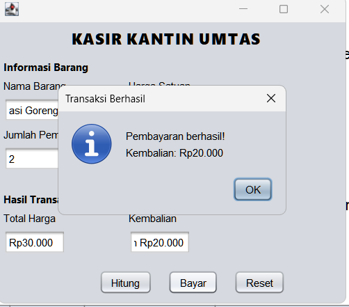
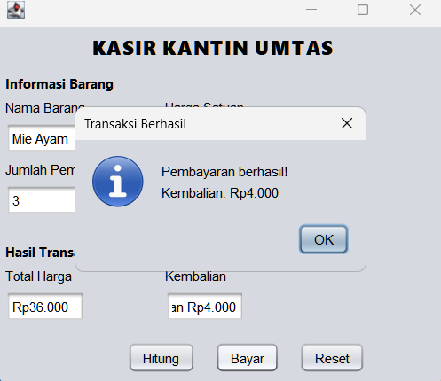
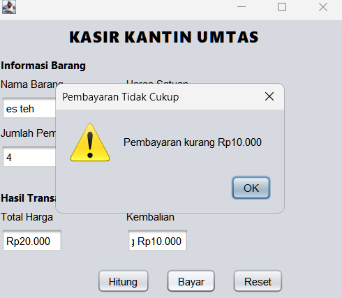
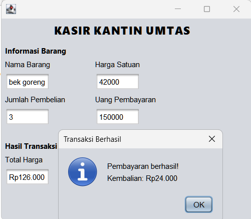
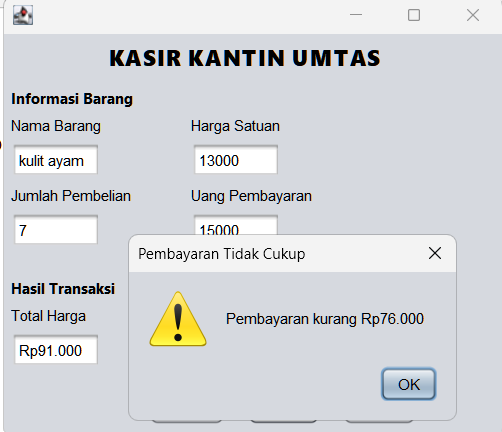

# KASIR UMTAS

## Identitas Pengembang

| Keterangan | Informasi |
|---|---|
| Nama Lengkap | Raihan Doan |
| NIM | C2483207005 |
| Kelas | PTI5A |
| Mata Kuliah | Pemrograman Visual |
| Nama Aplikasi | KASIR UMTAS |

## Deskripsi Aplikasi

KASIR UMTAS merupakan aplikasi desktop kasir sederhana yang dibuat menggunakan Java dan Java Swing. Aplikasi ini membantu proses transaksi di kantin kampus dengan menghitung total harga berdasarkan harga satuan dan jumlah pembelian, menerima pembayaran, serta menghitung uang kembalian. Aplikasi juga memberikan peringatan apabila data yang dimasukkan tidak valid atau pembayaran belum mencukupi. Aplikasi ini tidak menggunakan database.

## Fitur Aplikasi

1. **Input barang** – memasukkan nama makanan atau minuman yang dibeli.
2. **Input harga dan jumlah** – memasukkan harga satuan serta jumlah pembelian.
3. **Hitung total harga** – menghitung harga satuan dikalikan jumlah pembelian.
4. **Proses pembayaran** – memasukkan nominal uang yang dibayarkan.
5. **Hitung kembalian** – menampilkan uang kembalian apabila pembayaran mencukupi.
6. **Validasi pembayaran** – menampilkan peringatan apabila pembayaran kurang dari total harga.
7. **Validasi input** – memeriksa input wajib, karakter angka, harga atau pembayaran negatif, serta jumlah pembelian yang harus lebih dari nol.
8. **Reset transaksi** – mengosongkan kolom input dan hasil agar aplikasi siap digunakan untuk transaksi berikutnya.

## Komponen Java Swing yang Digunakan

| Komponen | Kegunaan |
|---|---|
| `JFrame` | Membuat jendela utama aplikasi. |
| `JPanel` | Mengelompokkan dan mengatur tata letak komponen. |
| `JLabel` | Menampilkan judul dan keterangan setiap kolom. |
| `JTextField` | Menerima input dan menampilkan hasil perhitungan. |
| `JButton` | Menjalankan perintah Hitung, Bayar, dan Reset. |
| `JOptionPane` | Menampilkan pesan informasi, validasi, dan peringatan. |

## Dokumentasi Screenshot

Screenshot berikut menunjukkan contoh hasil penggunaan dan pengujian aplikasi.

### 1. Transaksi Nasi Goreng

### 2. Transaksi Mie Ayam

### 3. Transaksi Es Teh

### 4. Transaksi Bebek

### 5. Transaksi Kulit Ayam

## Petunjuk Menjalankan Aplikasi

1. Pastikan Java Development Kit (JDK) dan Apache NetBeans IDE telah terpasang.
2. Unduh atau clone repository **KASIR UMTAS** ke komputer.
3. Buka Apache NetBeans IDE.
4. Pilih **File → Open Project**, kemudian pilih folder proyek KASIR UMTAS.
5. Tunggu hingga NetBeans selesai memuat proyek.
6. Jalankan proyek melalui **Run Project** atau tekan `F6`. Apabila diperlukan, pilih class utama aplikasi sebagai main class.
7. Setelah jendela aplikasi terbuka, isi nama barang, harga satuan, jumlah pembelian, dan uang pembayaran.
8. Klik **Hitung** untuk menampilkan total harga, lalu klik **Bayar** untuk memproses pembayaran dan melihat kembalian atau kekurangan pembayaran.
9. Klik **Reset** untuk mengosongkan formulir dan memulai transaksi berikutnya.

---

Dibuat sebagai tugas mata kuliah **Pemrograman Visual**.
